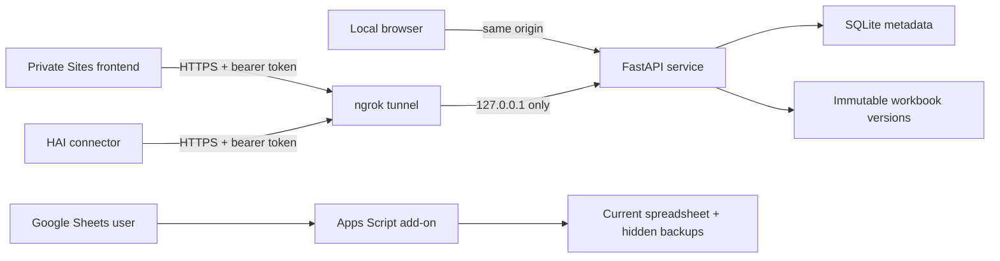

# Sheet Shaper

> Safety-first spreadsheet cleanup for CSV, XLSX, and Google Sheets—with an
> inspectable preview, explicit approval, a backup, and validation around every
> write.

[](https://github.com/Robert-Velhorst/027-Structuring-spreadsheets/actions/workflows/ci.yml?query=branch%3Acodex%2Fproduction-hardening-027)

Sheet Shaper turns inconsistent spreadsheet data into a cleaner, more regular
table. It can trim whitespace, normalize letter casing, remove duplicate or
empty rows and columns, split text, and sort rows. It is deterministic software,
not an AI model: the same input and options produce the same proposed output.

The project is designed around one rule: **seeing a preview is not permission to
change data**. A change is accepted only after this complete sequence:

```text
select or import → analyze → preview → acknowledge → backup → locked write → readback validation → optional restore
```

This repository contains two usable product surfaces built around that rule:

1. A **Windows 11 standalone workspace** for local CSV and XLSX files, with a
   React interface, FastAPI service, SQLite metadata, immutable workbook
   versions, optional ngrok access, and an HAI connector.
2. A **Google Sheets Editor add-on** that operates only in the spreadsheet
   currently open in Google Sheets and uses only current-document and container
   UI permissions.

They share the same transformation concepts, but they are separate runtimes.
There is no automatic synchronization between a local workbook and a Google
Sheet.

## Table of contents

- [Who this is for](#who-this-is-for)
- [What it does](#what-it-does)
- [Choose the right edition](#choose-the-right-edition)
- [How the safety workflow works](#how-the-safety-workflow-works)
- [Quick start for Windows](#quick-start-for-windows)
- [Using the standalone workspace](#using-the-standalone-workspace)
- [Cloud access with ngrok](#cloud-access-with-ngrok)
- [Private Sites frontend](#private-sites-frontend)
- [HAI connector](#hai-connector)
- [Google Sheets add-on](#google-sheets-add-on)
- [Architecture](#architecture)
- [Standalone API](#standalone-api)
- [Configuration reference](#configuration-reference)
- [Data storage and retention](#data-storage-and-retention)
- [Security and privacy model](#security-and-privacy-model)
- [Resource and performance boundaries](#resource-and-performance-boundaries)
- [Developer setup and verification](#developer-setup-and-verification)
- [Repository map](#repository-map)
- [Current status and limitations](#current-status-and-limitations)
- [Troubleshooting](#troubleshooting)
- [Frequently asked questions](#frequently-asked-questions)
- [Documentation index](#documentation-index)
- [License](#license)

## Who this is for

### Non-technical users

Sheet Shaper is useful when a spreadsheet contains issues such as:

- names padded with spaces;
- inconsistent `UPPERCASE`, `lowercase`, or title casing;
- duplicate records;
- blank rows or columns interrupting a table;
- values that need to be split into separate columns;
- rows that need a predictable sort order;
- uncertainty about what a cleanup action will change.

The interface shows the target, an issue summary, before/after dimensions,
sample cell differences, a risk label, and the expected quality score before it
enables **Apply once**.

### Developers and operators

The repository is also a reference implementation for:

- review-gated spreadsheet mutation;
- stale-preview and idempotency controls;
- durable backup-before-write behavior;
- readback validation;
- local-first Windows application packaging;
- a loopback-only service exposed through an authenticated ngrok tunnel;
- a read-and-preview-by-default automation connector;
- least-privilege Apps Script design.

## What it does

### Supported transformations

| Operation | Risk label | Result |
|---|---:|---|
| Smart trim | Low | Trims leading/trailing whitespace and collapses repeated spaces, tabs, and line breaks in text cells. |
| UPPERCASE | Low | Converts selected text cells to uppercase. |
| lowercase | Low | Converts selected text cells to lowercase. |
| Title Case | Low | Capitalizes words using locale-aware string operations. |
| Sentence case | Low | Lowercases text and capitalizes the start of sentences. |
| Remove duplicate rows | Medium | Keeps the first matching row; an optional first row is preserved as a header. |
| Compact empty rows | Medium | Removes rows whose cells are all empty. |
| Compact empty columns | Medium | Removes columns whose cells are all empty. |
| Split text | High | Splits one column on a delimiter and expands the resulting columns. |
| Sort rows | Medium | Sorts by one chosen column while optionally keeping the header fixed. |

Up to eight operations can run as an ordered batch. The order matters: for
example, trim followed by duplicate removal can detect duplicates that were not
identical before whitespace normalization.

The risk labels describe the potential size or shape of a change. They are not
a guarantee that a proposed change is appropriate for a particular dataset.

### Quality analysis

The quality report counts empty cells, whitespace issues, duplicate rows,
columns containing mixed value types, and total cells. It also returns a
heuristic score from 0 to 100 and low, medium, or high confidence based on
sample size.

The score is a cleanup indicator—not proof that data is factually correct,
complete, deduplicated according to a business definition, or safe to publish.

### File support

| Format | Standalone workspace | Google Sheets add-on | Notes |
|---|---:|---:|---|
| `.csv` | Yes | Yes | Standalone CSV must be UTF-8; comma, semicolon, tab, and pipe detection is supported. The add-on accepts comma, semicolon, or tab. |
| `.xlsx` | Yes | Not as an upload | Standalone processes the workbook's active worksheet and preserves formulas for non-shape-changing operations. |
| Native Google Sheet | No direct synchronization | Yes | The add-on works on the current selection or current sheet data region. |
| Legacy `.xls` | No | No | Convert it to `.xlsx` or `.csv` first. |
| PDF or images | No | No | This project does not perform OCR or document extraction. |

## Choose the right edition

| Need | Use | Important boundary |
|---|---|---|
| Clean a local CSV or XLSX file on one Windows computer | Standalone workspace | Data remains on that computer unless public/ngrok mode is enabled. |
| Clean cells inside an open Google Sheet | Google Sheets add-on | Requires an owner-controlled Apps Script deployment; it is not published in Marketplace. |
| Use the web interface from another device | Private Sites frontend + ngrok | Sites hosts only the interface; your Windows computer still runs the API and stores the files. |
| Let HAI inspect, analyze, or preview a workbook | HAI connector + authenticated endpoint | Read and preview are advertised by default; mutation is a separate operator opt-in. |
| Host a public multi-user spreadsheet service | Not this repository | The standalone service has one logical owner and one process; it is not a multi-tenant SaaS backend. |

## How the safety workflow works

1. **Select or import.** Choose a current Google Sheets target or upload a local
   `.csv`/`.xlsx` file.
2. **Analyze.** Read a bounded table and calculate issue counts without writing.
3. **Configure.** Select one to eight operations and their options.
4. **Preview.** Compute the proposed result, quality comparison, dimensions,
   risk, and up to 20 sample cell differences.
5. **Acknowledge.** Confirm that the target and preview were reviewed. This is
   required for every apply; saved presets do not bypass it.
6. **Check freshness.** Re-read the current input and reject the operation if
   the document or target changed after preview.
7. **Create and validate a backup.** Copy the source before writing and verify
   the backup hash/digest.
8. **Write once under a lock.** Serialize changes to the same document and use
   an idempotency key so retries do not duplicate an accepted operation.
9. **Read back.** Reopen the result and compare it with the preview digest.
10. **Restore if needed.** Restore only when the expected version is still
    current; a newer version causes a safe stale-restore error.

Previews expire after 10 minutes by default and cannot be reused after a
successful apply.

## Quick start for Windows

### What is currently distributed

The repository contains the source and scripts needed to create a one-folder
Windows build. It does **not** currently publish a signed installer or a GitHub
Release asset. A non-technical user should obtain the complete
`dist\SheetShaper` folder from a trusted operator who built and verified this
exact source revision. Do not copy only `SheetShaper.exe`; the adjacent runtime
files are required.

### Requirements for running from source

- Windows 11;
- Git;
- Python 3.11 or newer;
- Node.js 20, 22, or 24 (Node 24 is the CI-tested version);
- internet access during initial dependency installation.

### Install and start locally

Open PowerShell:

```powershell
git clone https://github.com/Robert-Velhorst/027-Structuring-spreadsheets.git
Set-Location .\027-Structuring-spreadsheets
git switch codex/production-hardening-027
.\scripts\windows\setup.ps1
.\scripts\windows\start-local.ps1
```

The setup command creates `apps\api\.venv`, installs the Python service, installs
the pinned frontend dependencies with pnpm 10.17.1, and builds the web client.
The start command binds only to `127.0.0.1`, selects the first available port
from 8765 through 8790, waits for readiness, opens the interface, and records
logs plus verified process identity under `%LOCALAPPDATA%\SheetShaper\runtime`.

Use `-NoBrowser` if the browser should not open automatically:

```powershell
.\scripts\windows\start-local.ps1 -NoBrowser
```

Stop only the recorded Sheet Shaper process with:

```powershell
.\scripts\windows\stop.ps1
```

The stop script checks the executable path and start time before terminating a
PID. It preserves imported workbooks, generated versions, backups, and the
database.

### Build the standalone executable

After setup:

```powershell
.\scripts\windows\build-standalone.ps1 -Clean
```

Output:

```text
dist\SheetShaper\
├── SheetShaper.exe
└── _internal\...
```

The build uses PyInstaller's one-folder mode and bundles the Python runtime,
API, workbook engine, dependencies, and compiled web client. The destination
computer does not need a separate Node.js or Python installation.

To run the packaged build, launch `SheetShaper.exe`, keep its console window
open, and visit `http://127.0.0.1:8765`. Close it with `Ctrl+C` when finished.
The executable is not code-signed, so Windows may display an unknown-publisher
warning.

## Using the standalone workspace

1. Open **Import spreadsheet** and choose a `.csv` or `.xlsx` file.
2. Select the imported document from the document list.
3. Inspect the visible grid and quality panel. The browser loads at most 100
   rows by 30 columns for this viewport; the complete workbook remains on disk.
4. Select the required transformations. The initial operation is Smart trim.
5. Press **Create preview**.
6. Review the target, risk, dimensions, score comparison, warnings, and sample
   differences.
7. Check **I reviewed the target and preview**.
8. Press **Apply once**.
9. Confirm that validation passed, then download the shaped file.
10. Use **History** to filter operations or restore the latest compatible
    backup.

Deleting a standalone document requires confirmation and removes that
document's source/result/backup files and associated document, version,
preview, and operation records. Minimal audit metadata—including generated IDs
and the fact that deletion occurred—may remain until bounded audit pruning; it
does not contain cell values or bearer tokens.

## Cloud access with ngrok

Cloud mode means the service still runs and stores files on the Windows
computer, while ngrok provides an HTTPS route to its loopback port. It is not an
independent hosted backend, and it stops when the local processes stop.

### Prerequisites

1. Install the ngrok v3 agent.
2. Authenticate it once:

   ```powershell
   ngrok config add-authtoken <your-ngrok-token>
   ```

3. Complete the normal Sheet Shaper setup.

### Start public mode

```powershell
.\scripts\windows\start-ngrok.ps1
```

The launcher keeps FastAPI on `127.0.0.1`, selects free application and ngrok
agent ports, starts a separate ngrok overlay, generates a strong bearer token,
protects it with current-user Windows DPAPI, applies an explicit origin
allowlist, verifies the exact HTTPS tunnel and upstream, performs an
authenticated capabilities request, copies the token to the clipboard, and
cleans up only its own processes if startup fails.

Public API and HAI requests require:

```http
Authorization: Bearer <token-copied-by-the-launcher>
```

To permit the private Sites frontend, supply its exact origin:

```powershell
.\scripts\windows\start-ngrok.ps1 `
  -AllowedOrigin 'https://sheet-shaper-workspace.noodzakelijkonline.chatgpt.site'
```

Multiple `-AllowedOrigin` values are accepted. Each must be HTTPS or a loopback
URL. Public mode applies a process-local limit of 120 API/HAI requests per
client IP per minute; it is a basic abuse guard, not a distributed rate limiter.

If ngrok reports `ERR_NGROK_334`, the account's assigned endpoint is already
online elsewhere. Stop or reconfigure that endpoint through its owner/account,
then retry. The launcher intentionally does not pool spreadsheet traffic with
an unrelated tunnel or stop another process it does not own.

## Private Sites frontend

The same React interface has an owner-only Sites deployment at:

<https://sheet-shaper-workspace.noodzakelijkonline.chatgpt.site>

Important: this deployment contains **only static interface assets and a small
worker that returns `SERVICE_NOT_CONFIGURED` for unconfigured API calls**. It
does not contain FastAPI, SQLite, workbook files, or a permanent Sheet Shaper
backend.

To use it:

1. Start the Windows service with `start-ngrok.ps1`, passing the Sites origin as
   shown above.
2. Open the Sites URL with an account that has access.
3. Open **Connections**.
4. Enter the verified ngrok HTTPS endpoint.
5. Enter the bearer token copied by the launcher.
6. Select **Save and verify**.

The frontend keeps the endpoint URL in browser `localStorage` and the bearer
token in `sessionStorage`. Closing that browser session clears the token. Sites
does not store workbook content; browser requests travel directly to the ngrok
endpoint configured by the user.

## HAI connector

The connector contract is under [`connectors/hai`](connectors/hai/README.md).
It uses the FastAPI OpenAPI description and the authenticated `/hai/v1` routes.

Default advertised capabilities are listing documents, reading bounded
document information, analyzing quality, and creating exact previews.

Apply and restore routes exist but are omitted from the advertised HAI
capabilities until the operator deliberately sets:

```powershell
$env:SS_HAI_MUTATIONS_ENABLED = 'true'
```

Enabling the flag does not bypass normal safety. HAI still needs a strong
bearer token, an unexpired preview, explicit acknowledgement, an idempotency
key, a validated backup, and successful readback validation.

Setup outline:

1. Start authenticated ngrok mode.
2. Make a private copy of
   [`connectors/hai/connector.json`](connectors/hai/connector.json).
3. Replace `REPLACE_WITH_NGROK_HOST` with the verified HTTPS endpoint.
4. Add the token to HAI's secure secret store as `SHEET_SHAPER_TOKEN`; never
   commit it.
5. Fetch `/hai/v1/manifest` and `/openapi.json` and confirm
   `readOnlyByDefault` is `true`.

This repository supplies a connector contract, not an automatic HAI
installation or credential exchange.

## Google Sheets add-on

### User experience

After an owner deploys and installs the Editor add-on, Google Sheets shows:

```text
Extensions → Sheet Shaper
├── Open Sheet Shaper
├── Run safety check
└── Help and privacy
```

The sidebar supports English and Dutch text, selection/data-region targeting,
ordered operation batches, analysis, previews, safe CSV import, explicit
acknowledgement, hidden backups, validated restore, up to 20 per-user presets,
filtered/paginated history, local CSV and privacy-safe support downloads, a
mutation safety stop, and user-owned metadata/backup deletion.

The add-on limit is 250,000 cells per run. Raw imported CSV is not persisted in
operation metadata. The newest 30 operation records and at most 10 referenced
hidden backup sheets are retained per user/spreadsheet namespace.

### Permissions

[`appsscript.json`](appsscript.json) requests exactly:

- `https://www.googleapis.com/auth/spreadsheets.currentonly`
- `https://www.googleapis.com/auth/script.container.ui`

Production scripts include `@OnlyCurrentDoc`. There is no Execution API, web
app endpoint, scheduled trigger, `UrlFetchApp`, Drive service, Gmail service,
Mail service, or enabled advanced Google service.

### Deploy an owner-controlled test add-on

Prerequisites: Node.js 20/22/24, an approved `clasp` installation, an
owner-controlled Apps Script project, and a synthetic-data test spreadsheet.

```powershell
npm ci
npm run verify
Copy-Item .clasp.example.json .clasp.json
```

Replace the placeholder in `.clasp.json` with the real Apps Script project ID,
confirm the authenticated Google account and project, then run:

```powershell
clasp push
```

The build output under `dist/` is the configured clasp root. Create a version
and an **Editor add-on test deployment** in Apps Script, install it only in a
synthetic test spreadsheet first, and follow
[`docs/CRITICAL_PATH.md`](docs/CRITICAL_PATH.md).

Never commit `.clasp.json`. Real OAuth consent, administrator policy,
two-account isolation testing, branding/privacy URLs, and Marketplace review
are owner/Google actions. This repository does not claim that a Marketplace
listing exists.

## Architecture



### Standalone components

- **`apps/web`** — React 19, TypeScript, Vite, accessible workspace UI, state,
  API client, connection configuration, history, and recovery controls.
- **`apps/api`** — FastAPI service, request/security boundary, deterministic
  engine, CSV/XLSX adapters, persistence service, and HAI routes.
- **SQLite** — document, version, preview, operation, and bounded audit
  metadata. Workbook bytes are not stored as SQLite blobs.
- **File store** — immutable source, backup, result, and restored workbook
  versions with SHA-256 hashes.
- **`apps/site`** — Sites/Cloudflare Worker-compatible delivery of the compiled
  frontend; deliberately no workbook backend.
- **`scripts/windows`** — dependency setup, local launch, authenticated ngrok
  launch, verified stop, and PyInstaller packaging.

### Google add-on components

- **`src/Core.gs`** — deterministic transformations, quality calculations,
  CSV parsing/serialization, diffing, and formula-aware values.
- **`src/Server.gs`** — Apps Script authorization boundary, preview cache,
  locks, backup/apply/restore, properties, history, presets, support, and safe
  RPC envelopes.
- **`src/Sidebar.html`** — accessible English/Dutch user workflow and local
  downloads.
- **`appsscript.json`** — V8 runtime and least-privilege OAuth scopes.

See [`docs/STANDALONE_ARCHITECTURE.md`](docs/STANDALONE_ARCHITECTURE.md) for the
persistence model and trust boundaries.

## Standalone API

Local Swagger UI is available at `/docs`. Interactive docs are disabled in
public mode; the OpenAPI document remains at `/openapi.json` for connector use.

### Authentication behavior

| Surface | Local mode | Public/ngrok mode |
|---|---|---|
| `/healthz`, `/readyz` | No token | No token; responses contain no workbook metadata |
| `/api/v1/*` | No token; protected by loopback-only binding | Bearer token required |
| `/hai/v1/*` | Bearer token required | Bearer token required |
| `/docs` | Available | Disabled |

The standalone service assigns every record to one logical owner,
`local-owner`. A bearer token separates authorized public clients from
unauthorized clients, but it does not create distinct user accounts or tenant
isolation.

### Endpoints

| Method | Path | Purpose |
|---|---|---|
| `GET` | `/healthz` | Process health and version. |
| `GET` | `/readyz` | Database readiness and local/public mode. |
| `GET` | `/api/v1/capabilities` | Limits, operation risk labels, mode, and HAI status. |
| `POST` | `/api/v1/documents` | Stream and import a `.csv` or `.xlsx` file. |
| `GET` | `/api/v1/documents` | List up to 100 documents, most recently updated first. |
| `GET` | `/api/v1/documents/{id}` | Read metadata, quality, and a bounded table window. |
| `DELETE` | `/api/v1/documents/{id}` | Delete a document and its stored workbook versions. |
| `POST` | `/api/v1/documents/{id}/preview` | Normalize a request and create an expiring preview. |
| `POST` | `/api/v1/documents/{id}/apply` | Apply one acknowledged, idempotent, validated preview. |
| `POST` | `/api/v1/operations/{id}/restore` | Restore a compatible backup version. |
| `GET` | `/api/v1/history` | Filter and page operation history. |
| `GET` | `/api/v1/documents/{id}/download` | Download the current version as `*-shaped.csv/xlsx`. |
| `GET` | `/hai/v1/manifest` | Read the HAI capability manifest. |
| `GET` | `/hai/v1/documents` | List HAI-visible documents. |
| `GET` | `/hai/v1/documents/{id}/analyze` | Return bounded document and quality information. |
| `POST` | `/hai/v1/documents/{id}/preview` | Create a reviewable HAI preview. |
| `POST` | `/hai/v1/documents/{id}/apply` | Apply only when HAI mutations are explicitly enabled. |
| `POST` | `/hai/v1/operations/{id}/restore` | Restore only when HAI mutations are explicitly enabled. |

Successful API responses use `{ "ok": true, "data": ... }`. Failures use a
stable code, safe message, retry indicator, and request ID without returning a
stack trace.

## Configuration reference

FastAPI reads environment variables with the `SS_` prefix.

| Variable | Default | Meaning and validation |
|---|---|---|
| `SS_DATA_DIR` | `%USERPROFILE%\AppData\Local\SheetShaper` for direct startup | SQLite and workbook-version root. Windows launchers explicitly use `%LOCALAPPDATA%\SheetShaper`. |
| `SS_HOST` | `127.0.0.1` | Only `127.0.0.1`, `localhost`, or `::1` is accepted. Non-loopback addresses fail startup. |
| `SS_PORT` | `8765` | Local HTTP port. Windows launchers find a free port through 8790. |
| `SS_PUBLIC_MODE` | `false` | Requires a bearer token and enables public-route authentication/rate limiting; it does not change the loopback bind. |
| `SS_API_TOKEN` | empty | Must contain at least 32 UTF-8 bytes in public mode or when HAI mutations are enabled. |
| `SS_ALLOWED_ORIGINS` | local port 8765 origins | Comma-separated CORS allowlist; never use a wildcard for credentialed public use. |
| `SS_MAX_UPLOAD_MB` | `25` | Per-file upload limit; accepted range is 1–100 MB. |
| `SS_MAX_CELLS` | `250000` | Maximum used cells in an import or operation target. |
| `SS_MAX_AUDIT_EVENTS` | `10000` | Bounded audit count; accepted range is 1,000–1,000,000. |
| `SS_PREVIEW_TTL_SECONDS` | `600` | Preview validity period. |
| `SS_HAI_MUTATIONS_ENABLED` | `false` | Separately advertises/allows HAI apply and restore. |
| `SS_WEB_DIST` | unset | Compiled frontend directory mounted at `/`. |
| `SS_WORKERS` | `1` | Must remain 1 because document locks are process-local. |

## Data storage and retention

### Standalone workspace

```text
%LOCALAPPDATA%\SheetShaper\
├── sheet-shaper.sqlite3
├── sheet-shaper.sqlite3-wal / -shm
├── files\<uuid-prefix>\<uuid>.csv|xlsx
└── runtime\
    ├── current.json
    ├── local-*.log / public-api-*.log / ngrok-*.log
    ├── ngrok-sheet-shaper.yml
    └── public-token.dpapi
```

- Source, backup, result, and restored files are immutable version records.
- SQLite stores paths, hashes, dimensions, timestamps, preview requests,
  summaries, validation metadata, and audit events—not workbook blobs.
- Preview metadata expires and is pruned.
- Workbook versions remain until the user deletes the document.
- Audit detail excludes cell content and tokens and is bounded at startup.
- Workbook files and SQLite are **not application-level encrypted at rest**.
  They rely on Windows account/filesystem protection. Only the public bearer
  token is protected with DPAPI by the ngrok launcher.

Back up the whole directory while Sheet Shaper is stopped if long-term local
recovery is required.

### Google Sheets add-on

- Cell content remains in Google Sheets and hidden backup sheets inside the same
  spreadsheet.
- Preview metadata lives in the user's Apps Script cache for at most 10 minutes.
- Settings, presets, and compact operations use User Properties.
- Operation metadata excludes cell values and formulas.
- Hidden sheets are recovery, not access control: spreadsheet editors may be
  able to unhide and view them.
- Google revision history is controlled by Google/the owner and cannot be
  deleted by the add-on with its current scopes.

## Security and privacy model

### Controls implemented

- loopback-only standalone binding;
- strong bearer token requirement before public mode starts;
- exact CORS origins, body/upload limits, and basic public rate limiting;
- CSP, no-sniff, no-referrer, permissions-policy, and no-store API headers;
- sanitized labels and generated server-side paths;
- malformed XLSX and invalid UTF-8 CSV rejection;
- escaping of formula-like CSV literals beginning with `=`, `+`, `-`, or `@`;
- formula preservation during safe XLSX text transformations;
- refusal to run shape-changing standalone operations on targets with formulas;
- expiring, single-use previews and stale hash/digest checks;
- per-document locks and idempotency uniqueness;
- backup validation before write and result validation after write;
- stale-safe restore and safe errors without stack traces;
- least-privilege Apps Script scopes and no external add-on transport.

### Residual risks

- The standalone service is for one trusted operator. Do not share its token
  among mutually untrusted users or expose it as a multi-user app.
- Local API routes rely on loopback rather than authentication; other software
  running locally may be able to call them.
- The public rate limiter resets on restart and is not internet-scale defense.
- HTTPS terminates at ngrok and traffic leaves the computer in public mode.
- Workbook files are not encrypted by Sheet Shaper at rest.
- XLSX support targets the active worksheet. Complex workbooks with macros,
  pivots, external links, protected structures, spills, or advanced formatting
  require an operator-controlled copy. `.xlsm` is not accepted.
- Quality scores do not establish factual/business correctness.
- Google Sheets collaborators may see hidden backups.
- Automated tests do not replace real Google authorization, administrator,
  collaborator, quota, accessibility, and Marketplace testing.

See [`docs/SECURITY.md`](docs/SECURITY.md) for the detailed add-on threat model.

## Resource and performance boundaries

- Default upload ceiling: 25 MB.
- Default standalone/add-on cell ceiling: 250,000.
- API table window: at most 200 rows × 50 columns; UI requests 100 × 30.
- Preview examples: at most 20.
- Operations per batch: at most 8.
- Standalone history page: 20 in UI, API maximum 50.
- Standalone document list: most recent 100.
- SQLite uses foreign keys, WAL, `synchronous=NORMAL`, a five-second busy
  timeout, indexed access paths, short transactions, and `PRAGMA optimize`.
- Blocking workbook work runs outside the asynchronous request loop.
- One Uvicorn process is enforced for process-local lock safety.
- The browser keeps a bounded window instead of a complete persisted workbook.
- There are no idle background jobs or automatic provider actions.

These limits favor predictable memory and recovery behavior over throughput.

## Developer setup and verification

### Root / Google Sheets add-on

```powershell
npm ci
npm run lint
npm test
npm run build
npm run doctor
```

Or run everything with `npm run verify`. The root package has no runtime npm
dependencies. The gates cover syntax, UI-to-server RPC wiring, transformation
behavior, adversarial inputs, scopes, absence of fake/external providers,
backup/write/validation ordering, restore ownership, safe errors, mocked Apps
Script integration, distribution output, and repository health.

### Standalone API

```powershell
.\scripts\windows\setup.ps1
.\apps\api\.venv\Scripts\python.exe -m pip install -e ".\apps\api[test,build]"
.\apps\api\.venv\Scripts\python.exe -m pytest .\apps\api\tests
```

### React frontend

```powershell
npx.cmd --yes pnpm@10.17.1 --dir .\apps\web install --frozen-lockfile
npx.cmd --yes pnpm@10.17.1 --dir .\apps\web run lint
npx.cmd --yes pnpm@10.17.1 --dir .\apps\web run test -- --pool=threads --maxWorkers=1 --no-file-parallelism
npx.cmd --yes pnpm@10.17.1 --dir .\apps\web run build
```

### Sites package

Build the frontend first, then:

```powershell
npx.cmd --yes pnpm@10.17.1 --dir .\apps\site install --frozen-lockfile
npx.cmd --yes pnpm@10.17.1 --dir .\apps\site run build
```

This creates a frontend-only Sites artifact; it does not deploy a backend.

### CI

[`quality-gates`](.github/workflows/ci.yml) runs on pushes and pull requests.
Ubuntu verifies the add-on with Node 24. Windows verifies pinned frontend
dependencies, lint/tests/build, Python 3.13 API tests, PowerShell parsing,
PyInstaller packaging, and packaged-runtime readiness. CI has read-only
repository permissions.

## Repository map

```text
.
├── .github/workflows/ci.yml     GitHub Actions quality gates
├── apps/
│   ├── api/                     FastAPI, SQLite, engine, adapters, tests
│   ├── web/                     React/Vite workspace and UI tests
│   └── site/                    Frontend-only Sites worker/package
├── connectors/hai/              HAI contract and setup guide
├── docs/                         Architecture, audits, runbooks, evidence
├── scripts/
│   ├── build.mjs                Apps Script distribution build
│   ├── doctor.mjs               Manifest/environment checks
│   ├── lint.mjs                 Apps Script/sidebar contract lint
│   └── windows/                 Setup, launch, ngrok, stop, packaging
├── src/
│   ├── Core.gs                  Deterministic add-on engine
│   ├── Server.gs                Apps Script safety/storage/recovery
│   └── Sidebar.html             Bilingual Google Sheets sidebar
├── test/                         Add-on unit/contract/integration tests
├── appsscript.json               Least-privilege manifest
├── package.json                  Root build/test commands
└── README.md                     This guide
```

Generated/local paths such as `dist/`, `build/`, `.venv/`, `.clasp.json`,
`.env*`, logs, databases, and PyInstaller specs are ignored by Git.

## Current status and limitations

This README documents version 3.0.0 on branch
`codex/production-hardening-027`. The GitHub default branch is still `main`, and
the production-hardening branch has not been merged into it.

### Implemented and repository-verified

- deterministic Google Sheets transformations and review-gated writes;
- standalone React/FastAPI/SQLite CSV/XLSX workflow;
- Windows source launch and one-folder packaging;
- fail-closed authenticated ngrok launcher;
- HAI read/preview-default API contract;
- frontend-only private Sites deployment;
- automated add-on, API, UI, packaging, and runtime gates.

### Requires owner or external-system action

- resolving any ngrok account/domain conflict and performing fresh public/HAI
  acceptance;
- creating/authorizing a real Apps Script project;
- Google editor/collaborator/quota/accessibility and administrator testing;
- Marketplace review, if publication is desired;
- signing/distributing a Windows installer or release archive;
- granting access to the private Sites deployment.

### Deliberately not included

- AI/LLM transformations;
- Gmail or Google Drive integration;
- automatic cloud workbook storage;
- background schedules, hidden retries, or autonomous writes;
- charts, pivots, sharing changes, notifications, PDF/image handling;
- `.xls` or `.xlsm` processing;
- multi-tenant accounts, roles, billing, or internet-scale hosting;
- synchronization between standalone files and Google Sheets.

See [`docs/FINAL_VERIFICATION_REPORT.md`](docs/FINAL_VERIFICATION_REPORT.md) and
[`docs/GOAL_COMPLETION_MATRIX.md`](docs/GOAL_COMPLETION_MATRIX.md) for evidence
and external gates.

## Troubleshooting

### Service did not become ready

Read `%LOCALAPPDATA%\SheetShaper\runtime\local-error.log` or
`public-api-error.log`, confirm setup completed, and try a free explicit port:

```powershell
.\scripts\windows\start-local.ps1 -Port 8770
```

### `SERVICE_UNAVAILABLE`

Start the local/ngrok service. In Sites, open **Connections** and verify the
endpoint. Confirm the ngrok process and URL are still active.

### `NOT_AUTHORIZED`

Enter the bearer token copied by the ngrok launcher. Do not paste the ngrok
account authtoken; it is a different secret.

### `STALE_PREVIEW` or `PREVIEW_EXPIRED`

Refresh, inspect the latest target, and create a new preview. Do not reuse the
old acknowledgement.

### `BUSY`

Another mutation owns the lock. Wait briefly, inspect history/document state,
and retry only after confirming the previous operation.

### `RANGE_TOO_LARGE` or `UPLOAD_TOO_LARGE`

Split the workbook or selection. Avoid raising limits before testing backup and
restore on representative files.

### Formula-related shape change rejected

Use a formula-free target or a non-shape-changing text operation. The engine
refuses to guess how formulas should move.

### `STALE_RESTORE`

A newer version exists. Restore in reverse operation order or inspect/download
the current version before taking further action.

### `ERR_NGROK_334`

The assigned endpoint is active elsewhere. Resolve it through its owner/account;
do not pool unrelated spreadsheet traffic.

### Google add-on menu is missing

Confirm the Editor add-on test deployment is installed for the active account
and spreadsheet, then reload Sheets. The repository does not install it.

More detail: [`docs/TROUBLESHOOTING.md`](docs/TROUBLESHOOTING.md) and
[`docs/OPERATOR_RUNBOOK.md`](docs/OPERATOR_RUNBOOK.md).

## Frequently asked questions

### Does Sheet Shaper use AI?

No. Its transformation and quality engines are deterministic.

### Will it modify my original data?

Analysis and preview do not write. **Apply once** creates a backup before the
write and validates afterward. You must still review the target and keep
independent backups for important data.

### Can I undo a change?

Yes, while the expected result remains current and the backup exists. A newer
change makes an older direct restore stale by design.

### Does local mode require internet?

Initial source installation does. After setup, standalone local runtime uses
loopback and does not require ngrok. Google Sheets and ngrok modes use external
services.

### Is the Sites URL a complete cloud application?

No. It is a private frontend. A Windows computer must run the authenticated API
and ngrok endpoint.

### Can several unrelated people share one public endpoint?

That is unsupported. The API has one logical owner and shared bearer token.

### Are local workbooks encrypted?

Not by Sheet Shaper. They rely on Windows filesystem/account protection.

### Does the add-on send data to FastAPI?

No. The add-on and standalone workspace are separate; the add-on has no remote
fetch service.

### Does it connect to Gmail or Google Drive?

No. Those services are absent from production code and OAuth scopes.

### Is it in Marketplace or available as a signed installer?

No. Those release steps remain owner-controlled work.

## Documentation index

| Document | Purpose |
|---|---|
| [`CHANGELOG.md`](CHANGELOG.md) | Version history and known limitations. |
| [`docs/STANDALONE_ARCHITECTURE.md`](docs/STANDALONE_ARCHITECTURE.md) | Runtime, trust boundaries, persistence, performance. |
| [`docs/CRITICAL_PATH.md`](docs/CRITICAL_PATH.md) | Manual Google-hosted acceptance workflow. |
| [`docs/OPERATOR_RUNBOOK.md`](docs/OPERATOR_RUNBOOK.md) | Deployment, canary, rollback, recovery. |
| [`docs/SECURITY.md`](docs/SECURITY.md) | Threat model, retention, incident response. |
| [`docs/TROUBLESHOOTING.md`](docs/TROUBLESHOOTING.md) | Error-specific next actions. |
| [`docs/FINAL_VERIFICATION_REPORT.md`](docs/FINAL_VERIFICATION_REPORT.md) | Verification evidence and blockers. |
| [`docs/GOAL_COMPLETION_MATRIX.md`](docs/GOAL_COMPLETION_MATRIX.md) | Detailed implementation status. |
| [`docs/TECHNICAL_AUDIT.md`](docs/TECHNICAL_AUDIT.md) | Repository/implementation audit. |
| [`docs/API_USAGE_AUDIT.md`](docs/API_USAGE_AUDIT.md) | Google service and OAuth inventory. |
| [`docs/UI_ACTION_AUDIT.md`](docs/UI_ACTION_AUDIT.md) | Sidebar action-to-handler map. |
| [`connectors/hai/README.md`](connectors/hai/README.md) | HAI integration guide. |

## License

This repository does not currently contain a `LICENSE` file. Do not assume that
the source may be copied, redistributed, or used commercially. Contact the
repository owner for permission and licensing terms.
